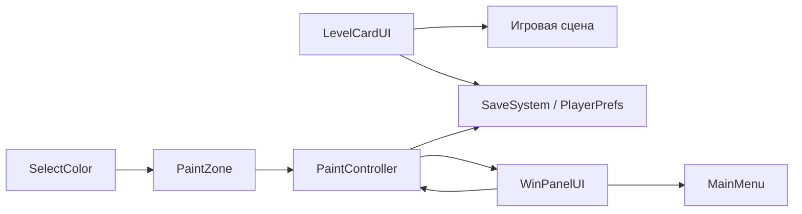

# Архитектура

«Умная раскраска» — мобильная 2D-игра: выбрать цвет и нажатием заполнить его группу участков.
Подтверждённая версия — Unity 6000.4.4f1; основная цель Android.
Версии проверять в [ProjectVersion](../ProjectSettings/ProjectVersion.txt) и [manifest](../Packages/manifest.json).

## Входы и размещение

- [MainMenu](../Assets/_Project/Scenes/MainMenu.unity) — карточки и сброс.
- [Сцены уровней](SCENE_MAP.md) — экземпляры общих runtime-компонентов.
- `Assets/_Project/Art/` — изображения; `Assets/_Project/Prefabs/` — вспомогательные префабы номеров.
- `Assets/_Project/UI/WinPanel/` — общий экран завершения.
- `Assets/_Project/Editor/LevelCreation/` и `Tools/LevelCreation/` — редакторский и файловый конвейер.
- `ArtSources/` — оригиналы и рабочая геометрия вне импорта Unity.
- `ProjectSettings/EditorBuildSettings.asset` — включённые сцены; отдельный активный BuildProfile при проверке не выбран.
- `docs/` — стабильные знания; игнорируемый `AgentSync/` — оперативные отчёты и частные ID Drive.

## Компоненты

| Файл | Ответственность / связи |
|---|---|
| [PaintController](../Assets/_Project/Scripts/PaintController.cs) | Singleton сцены; массивы зон/палитры; подсчёт, SaveSystem, replay и WinPanel; LoadNextLevel |
| [PaintZone](../Assets/_Project/Scripts/PaintZone.cs) | SpriteRenderer + Collider2D; OnMouseDown → Paint; проверка colorId, анимация alpha, уведомление контроллера |
| [SelectColor](../Assets/_Project/Scripts/SelectColor.cs) | Выбранный ID, подсветка зон, 10-секундная подсказка, скрытие кнопки |
| [SaveSystem](../Assets/_Project/Scripts/SaveSystem.cs) | Статический слой PlayerPrefs: цвет/завершение по имени сцены, регистрация ID, сброс и звук |
| [MainMenuController](../Assets/_Project/Scripts/MainMenuController.cs) | Карточки, список сцен для сброса; сохранены старые вспомогательные поля двух уровней |
| [LevelCardUI](../Assets/_Project/Scripts/LevelCardUI.cs) | Имя сцены, два превью, кнопка; Start регистрирует OpenLevel, Refresh читает SaveSystem |
| [CameraZoomAndPan](../Assets/_Project/Scripts/CameraZoomAndPan.cs) | Ортокамера, fit в GameplayViewport, pan/zoom/touch, отдельная фоновая камера |
| [PaletteDragScroll](../Assets/_Project/Scripts/PaletteDragScroll.cs) | Настройка ScrollRect, HorizontalLayoutGroup и ContentSizeFitter, обновление после удаления кнопок |
| [ProjectScanner](../Assets/_Project/Scripts/ProjectScanner.cs) | Диагностика групп, контроллера, палитры и Collider2D. Считает PaintZone-объекты, не островки PNG |
| [GameSound](../Assets/_Project/Scripts/GameSound.cs) | Singleton сцены; AudioSource.PlayOneShot(clickSound), учёт настройки звука |
| [SoundToggleButton](../Assets/_Project/Scripts/SoundToggleButton.cs) | Кнопка звука и спрайты включено/выключено |
| [BackToMenu](../Assets/_Project/Scripts/BackToMenu.cs) | LoadScene(MainMenu) |
| [WinPanelUI](../Assets/_Project/UI/WinPanel/Scripts/WinPanelUI.cs) | Делегирует Next контроллеру, Menu — BackToMenu |
| [UIButtonPressAnimation](../Assets/_Project/Scripts/UIButtonPressAnimation.cs) | Доступный вспомогательный обработчик нажатия; не считать назначенным каждой кнопке автоматически |
| [LevelPreviewCard](../Assets/_Project/Scripts/LevelPreviewCard.cs) | Старый вспомогательный компонент превью; текущая система карточек — LevelCardUI |

## Внешние зависимости

Подтверждены UPM: Input System 1.19.0, uGUI 2.0.0, Sprite 1.0.0, Pipeline 0.6.0-exp.1,
Unity AI Assistant 2.13.0-pre.2, Test Framework 1.6.0, Purchasing 4.15.0, Ads 4.16.4.
Их установка **не подтверждает** настроенные покупки, рекламу или backend.
Полный список — инвентарь/manifest; версии без необходимости не менять.
Генерация PNG требует Pillow + numpy, отчёты — Python standard library + PowerShell + Git.
